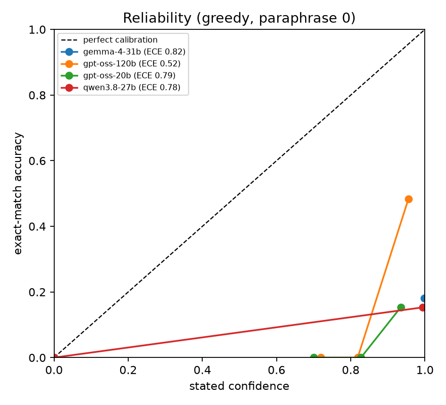
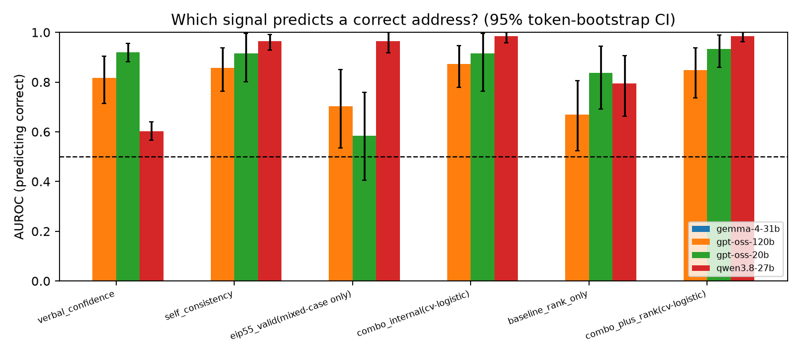
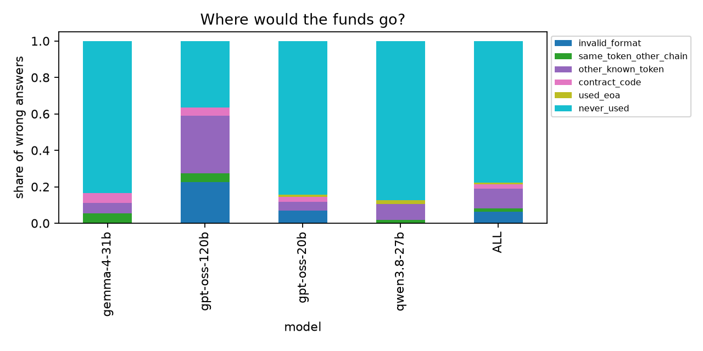

Confident to the Last Hex Digit: Do LLMs Know When a Recalled Contract Address Is Wrong?1

<b>Ahmardchain (Ahmad Aminu)</b> Usmanu Danfodiyo University, Gusau, Nigeria ahmardchain@gmail.com

<b>With</b> Apart Research

<b>Abstract</b> 
AI agents that hold wallets increasingly have to decide whether to trust a token contract address recalled from model memory or to look it up. One wrong hex digit sends funds somewhere irreversible. We built a cross-validated set of 313 ERC-20 tokens on Ethereum and Base, stratified by market-cap rank, and asked four free-tier open-weight models (gemma-4-31b, gpt-oss-120b, gpt-oss-20b, qwen3.8-27b) for each address with a 0–100 confidence, under three paraphrases and three T=1 resamples. On the 313 tokens all four models completed, pooled exact-match accuracy is 5.2% [3.4, 7.0] (95% token-bootstrap CI). Models abstain often (62.8%), but when they answer they are usually wrong (80.5%), and 82.5% of wrong answers carry confidence ≥ 90. Verbal confidence is a weak error detector (pooled AUROC 0.701 [0.647, 0.748]), barely above a market-cap-rank baseline (0.744 [0.636, 0.830]). Self-consistency across three resamples is much stronger (0.919 [0.875, 0.957]; paired difference 0.218 [0.172, 0.271]). Checking each wrong address on-chain, 208 of 268 (77.6%) point to never-used addresses where funds would be burned, and 29 point to a different known token. A rule that trusts only fully self-consistent answers blocks 97.8% of wrong answers but keeps only 44.6% of correct ones. The takeaway for agent builders: a model's stated confidence in a recalled address should never authorise a transfer; resolve addresses from a verified registry.

## 1. Introduction

Wallet agents, trading bots and coding assistants now write and sign blockchain transactions. A common step is "what is the contract address of token X on chain Y?" A model can answer from memory or the agent can look it up in a token list or explorer. Lookups cost latency and tooling, so in practice agents and their users often take the model's answer, sometimes gated by the model's own confidence. Unlike most hallucinations, a wrong address is not merely misleading: a transfer to it is irreversible, and if the address belongs to someone else's contract (for example a look-alike token) it can be exploited, as address-poisoning attacks already show at scale [Tsuchiya et al., 2025].

This makes contract addresses a clean testbed for an epistemics question: **does a model know when its own recalled fact is wrong, in a domain where the fact is either exactly right or useless?** Addresses are 40 hex characters with no partial credit, ground truth is checkable, and the Ethereum EIP-55 mixed-case checksum [Buterin & Van de Sande, 2016] gives a free, model-independent signal.

Our main contributions are:

1. **A pre-registered, zero-budget benchmark** of 313 cross-validated ERC-20 addresses on Ethereum and Base, stratified by popularity, with code that refuses any paid model and resumes across free-tier quota windows.
2. **A calibration and error-detection comparison** of verbal confidence, self-consistency, the EIP-55 checksum, a combined classifier and a popularity-only baseline, with token-level bootstrap CIs, on four open-weight models.
3. **An on-chain consequence analysis** that classifies where every wrong answer would actually send funds (burned, another token, another contract, a live account), reported only as aggregates.

## 2. Related Work

**Package hallucination.** Spracklen et al. [2025] showed that code-generating LLMs recommend non-existent software packages at substantial rates, creating a supply-chain attack ("slopsquatting") when attackers register those names. Contract addresses are the on-chain analogue, with a sharper failure mode: a wrong address does not fail to install, it silently receives funds. We add confidence and on-chain destination analysis, which that work did not need.

**Address poisoning.** Tsuchiya et al. [2025] measured blockchain address-poisoning attacks, where attackers plant look-alike addresses in a victim's history hoping the victim copies them. Our "other known token / other contract" categories measure a related risk created by the model itself rather than by an attacker.

**Do models know what they know?** Kadavath et al. [2022] found that large models are reasonably calibrated about their own answers in some settings, while Xiong et al. [2024] and Tian et al. [2023] found verbalised confidence to be overconfident and sensitive to elicitation. Sampling-based consistency, as in self-consistency [Wang et al., 2023] and SelfCheckGPT [Manakul et al., 2023], is a standard black-box alternative. We test these signals in a domain with exact, verifiable answers and real-money stakes, and compare them against a popularity baseline.

**Long-tail knowledge.** Mallen et al. [2023] and Kandpal et al. [2023] showed factual recall collapses for less popular entities. We stratify by market-cap rank and include rank as a baseline predictor, so we can ask whether models' signals add anything beyond "is this a famous token?"

Calibration metrics follow Guo et al. [2017] (ECE) and Brier [1950].

## 3. Methods

**Dataset.** From CoinGecko's coin list and market ranks we take each token's Ethereum or Base contract address. An Ethereum token is kept only if the same address and symbol also appear in the Uniswap Labs default list (strict) or, as a fallback, the CoinMarketCap or 1inch lists (extended). Addresses shared by two or more CoinGecko coins are dropped. Base tokens must agree between CoinGecko's coin list and its Base token list; those also in Uniswap or Superchain lists are sampled first. Strata are Ethereum rank ≤100, 101–1000, >1000, and Base, with a fixed seed. Only 53 Ethereum ERC-20s in the top 100 survive cross-validation (most top-100 assets are native L1 coins), giving 313 tokens: 53 / 100 / 100 / 60. An address universe of 30,684 known token addresses is used to classify wrong answers.

**Models and prompting.** Four open-weight models on free tiers: gemma-4-31b (Google AI Studio), gpt-oss-120b, gpt-oss-20b and qwen3.8-27b (Groq). Each prompt asks the model to act as a wallet agent and reply only with JSON `{"address": "0x...", "confidence_0_100": n}` or `{"abstain": true}` (Appendix B). Per token and model we make 6 calls: three paraphrases at T=0 (paraphrase 0 is the primary answer; 1–2 measure prompt sensitivity) and three T=1 samples on paraphrase 0. Reasoning is disabled where the API allows, otherwise set to low with a larger token cap.

**Scoring.** The unit of analysis is the greedy answer to paraphrase 0 per (token, model). *Answered* means the model committed to a concrete address (abstentions, placeholders and unparseable or truncated outputs are non-answers). Accuracy is case-insensitive exact match to the gold address. We report ECE (10 bins) and Brier on stated confidence, and the *confident-wrong* rate (wrong with confidence ≥ 90). For error detection we compute AUROC for predicting a correct answer from: verbal confidence; self-consistency (share of T=1 samples equal to the greedy address); EIP-55 validity (only for mixed-case outputs); an out-of-fold logistic combination of these, cross-validated grouped by token; and the **baseline** of market-cap rank alone. Always-trust has AUROC 0.5 by construction. AUROC is reported only when there are at least 5 correct and 5 wrong answers. All 95% CIs are cluster bootstraps over tokens (1,000 resamples).

**On-chain destinations.** Each wrong, answered greedy address is classified, via public RPC on its chain, as: invalid format; the same token's address on the other chain; another known token; some other contract; a used externally owned account (nonce or balance > 0); or a never-used address (no code, nonce 0, balance 0, so funds sent there are effectively burned).

**Shared subset.** Free-tier quotas (and Google's unstable Gemma endpoint) initially prevented every model from finishing the full 1,878-call design; the retry loop later completed it for all four retained models. Items were queried in a pre-registered, stratum-interleaved random order fixed from the dataset alone, so any prefix is an approximately stratified random sample. All headline metrics use the **same 313 tokens for every model**: the full 313-token design, with 0 tokens excluded: every call of every retained model succeeded. The stricter original rule (stop each model's prefix at its 4th failed item) therefore also yields 313 tokens (§4.5).

## 4. Results

Table 0 gives coverage. The shared subset has 53 Eth. rank ≤100, 100 Eth. 101–1000, 100 Eth. >1000, 60 Base tokens (full design: 53, 100, 100, 60).

**Table 0.** Calls completed per model at the final run (2026-11-16 03:05+01:00 WAT), and tokens used.

| Model | successful calls on disk (of 1,878) | tokens with all 6 calls (of 313) | used in shared subset |
|---|---|---|---|
| gemma-4-31b | 1,878 | 313 | 313 |
| gpt-oss-120b | 1,878 | 313 | 313 |
| gpt-oss-20b | 1,878 | 313 | 313 |
| qwen3.8-27b | 1,878 | 313 | 313 |
| gemini-3.1-flash-lite | 363 (dropped) | — | not reported |

### 4.1 Accuracy and calibration

**Table 1.** Headline metrics on the shared subset (n = 313 tokens per model). Brackets: 95% token-bootstrap CI. "Answered" n is the number of committed addresses used for accuracy (answered), confident-wrong, ECE and Brier.

| Model | n tokens | answered | abstained | accuracy (all) | accuracy (answered) | confident-wrong (conf≥90, of answered) | ECE | Brier |
|---|---|---|---|---|---|---|---|---|
| gemma-4-31b | 313 | 7.0% (n=22) | 60.1% | 1.3% [0.3, 2.6] | 18.2% [4.5, 36.4] | 81.8% [63.6, 95.5] | 0.816 [0.636, 0.955] | 0.814 [0.636, 0.955] |
| gpt-oss-120b | 313 | 23.6% (n=74) | 76.0% | 9.6% [6.7, 12.8] | 40.5% [29.7, 51.4] | 43.2% [32.4, 54.1] | 0.523 [0.424, 0.627] | 0.484 [0.398, 0.578] |
| gpt-oss-20b | 313 | 37.4% (n=117) | 53.4% | 4.5% [2.2, 6.7] | 12.0% [6.0, 17.9] | 65.8% [57.3, 74.4] | 0.785 [0.732, 0.839] | 0.705 [0.653, 0.757] |
| qwen3.8-27b | 313 | 38.3% (n=120) | 61.7% | 5.4% [3.2, 8.0] | 14.2% [8.3, 20.8] | 78.3% [70.8, 85.0] | 0.778 [0.704, 0.846] | 0.774 [0.699, 0.842] |
| **pooled** | 1252 | 26.6% (n=333) | 62.8% | 5.2% [3.4, 7.0] | 19.5% [13.4, 25.4] | 66.4% [60.7, 72.4] | 0.726 [0.667, 0.785] | 0.688 [0.633, 0.744] |

*Observation.* Recall is poor: pooled accuracy is 5.2% [3.4, 7.0], and even the best model, gpt-oss-120b, recalls 9.6% [6.7, 12.8] of addresses. Models abstain on most tokens, which is the safe behaviour, but when they do answer they are wrong 80.5% of the time, and 221 of 268 wrong answers (82.5%) come with confidence ≥ 90. ECE ranges from 0.523 to 0.816; Figure 1 shows almost every answer sits at stated confidence 0.8–1.0 while accuracy stays far below the diagonal. gemma-4-31b answered only 22 of 313 tokens: in 32.9% of cases its visible thinking looped (for example repeating a guessed address with runs of identical digits) until the 1500-token cap, which we count as a non-answer, so its per-answer metrics have wide CIs.

<figure><figcaption><b>Figure 1.</b> Reliability diagram for the greedy answer (paraphrase 0) on the shared subset, one line per model. The dashed diagonal is perfect calibration; every model is far below it at high stated confidence.</figcaption></figure>

**Table 2.** Exact-match accuracy by popularity stratum (shared subset; per-stratum n tokens in header).

| Model | Eth. rank ≤100 (n=53) | Eth. 101–1000 (n=100) | Eth. >1000 (n=100) | Base (n=60) |
|---|---|---|---|---|
| gemma-4-31b | 7.5% | 0.0% | 0.0% | 0.0% |
| gpt-oss-120b | 22.6% | 9.0% | 9.0% | 0.0% |
| gpt-oss-20b | 15.1% | 5.0% | 1.0% | 0.0% |
| qwen3.8-27b | 17.0% | 7.0% | 1.0% | 0.0% |
| **pooled** | 15.6% | 5.2% | 2.8% | 0.0% |

Accuracy is highest for top-100 Ethereum tokens and near zero below that, and no model recalled a single Base address correctly, consistent with long-tail findings [Mallen et al., 2023; Kandpal et al., 2023]. Prompt wording matters little: the pooled max–min accuracy spread across the three paraphrases is 0.006.

### 4.2 Which signal predicts a wrong address?

**Table 3.** AUROC for predicting that an answered address is correct (95% token-bootstrap CI). gemma-4-31b is omitted (fewer than 5 correct answers). The pooled column mixes models and is shown for reference.

| Signal | gpt-oss-120b | gpt-oss-20b | qwen3.8-27b | pooled |
|---|---|---|---|---|
| Verbal confidence | 0.818 [0.713, 0.903] | 0.920 [0.882, 0.955] | 0.602 [0.567, 0.640] | 0.701 [0.647, 0.748] (n=333) |
| Self-consistency (3 × T=1) | 0.857 [0.763, 0.937] | 0.915 [0.800, 0.995] | 0.963 [0.929, 0.990] | 0.919 [0.875, 0.957] (n=333) |
| EIP-55 checksum (mixed-case only) | 0.703 [0.536, 0.850] | 0.585 [0.405, 0.758] | 0.964 [0.917, 1.000] | 0.814 [0.735, 0.884] (n=132) |
| Combined, CV logistic | 0.872 [0.779, 0.948] | 0.916 [0.762, 0.997] | 0.984 [0.958, 1.000] | 0.945 [0.910, 0.973] (n=333) |
| Baseline: market-cap rank only | 0.669 [0.523, 0.806] | 0.838 [0.692, 0.944] | 0.794 [0.662, 0.907] | 0.744 [0.636, 0.830] (n=333) |
| Combined + rank, CV logistic | 0.848 [0.737, 0.938] | 0.934 [0.859, 0.988] | 0.984 [0.962, 1.000] | 0.940 [0.909, 0.966] (n=333) |

<figure><figcaption><b>Figure 2.</b> AUROC of each error-detection signal per model, with 95% token-bootstrap CIs; dashed line = chance (always-trust). gemma-4-31b has too few correct answers to score. Self-consistency is high for every model; verbal confidence varies widely and is near chance for qwen3.8-27b.</figcaption></figure>

*Observation.* Self-consistency beats verbal confidence pooled (paired difference 0.218 [0.172, 0.271], n = 333 answers) and most clearly for qwen3.8-27b (0.362 [0.303, 0.412]), whose stated confidence is near-constant. For the two gpt-oss models the difference is not significant (0.039 [-0.033, 0.119] and -0.005 [-0.113, 0.076]): their verbal confidence is informative. The popularity-only baseline is competitive with verbal confidence (0.744 [0.636, 0.830] pooled), so verbal confidence mostly re-encodes "is this a famous token". The EIP-55 checksum, when the model emits mixed case, is informative for qwen3.8-27b but not for gpt-oss-20b. As a reference, random mixed-case strings pass EIP-55 at rate 0.00000 (50k simulated) and a single case flip of a true address at 0.00000, so a valid checksum on a wrong address means the model memorised a real checksummed address, just the wrong one.

### 4.3 What would a trust rule do?

**Table 4.** Simple gating rules on the 333 answered greedy addresses (pooled over models, shared subset).

| Trust rule (on answered greedy addresses) | trusted | accuracy when trusted | wrong answers blocked | correct answers kept |
|---|---|---|---|---|
| Trust if stated confidence ≥ 90 | 286/333 (85.9%) | 22.7% | 17.5% of 268 | 100.0% of 65 |
| Trust only if all 3 T=1 samples repeat the greedy address | 35/333 (10.5%) | 82.9% | 97.8% of 268 | 44.6% of 65 |
| … and EIP-55 checksum not failed | 33/333 (9.9%) | 81.8% | 97.8% of 268 | 41.5% of 65 |

Gating on stated confidence ≥ 90 passes 85.9% of answers and blocks only 17.5% of wrong ones. Requiring all three resamples to agree blocks 97.8% of wrong answers, but those trusted are still only 82.9% accurate (35 answers), which is not safe enough for an irreversible transfer.

### 4.4 Where would the money go?

**Table 5.** On-chain destination of every wrong, answered greedy address (counts; aggregates only).

| Model | same token other chain | other known token | contract code | used eoa | never used | invalid format | n wrong |
|---|---|---|---|---|---|---|---|
| gemma-4-31b | 1 | 1 | 1 | 0 | 15 | 0 | 18 |
| gpt-oss-120b | 2 | 14 | 2 | 0 | 16 | 10 | 44 |
| gpt-oss-20b | 0 | 5 | 3 | 1 | 87 | 7 | 103 |
| qwen3.8-27b | 2 | 9 | 0 | 2 | 90 | 0 | 103 |
| **pooled** | 5 | 29 | 6 | 3 | 208 | 17 | 268 |

<figure><figcaption><b>Figure 3.</b> Share of wrong answers by on-chain destination, per model. "never used" = no code, nonce 0, zero balance: funds sent there are effectively burned.</figcaption></figure>

208 of 268 wrong answers (77.6%) are never-used addresses, so the dominant failure is a plausible-looking fabricated address that burns funds. 29 (10.8%) are the address of a *different* known token, the case where an attacker or a look-alike token could profit, and 17 are not valid 40-hex addresses at all (a cheap format check catches these).

### 4.5 Robustness

Under the stricter original subset rule the subset is the same 313 tokens (all calls completed), so the results are identical: pooled accuracy 5.2% [3.4, 7.0], wrong answers with confidence ≥ 90 82.5%, AUROC verbal confidence 0.701 [0.647, 0.748] vs self-consistency 0.919 [0.875, 0.957] (paired difference 0.218 [0.172, 0.271]). Results are also stable across the three paraphrases (§4.1).

## 5. Discussion and Limitations

**Implications for AI safety and agent design.** In this domain models usually *do* sense that they do not know, since they abstain on 62.8% of tokens, but the confidence they attach to the answers they do give is close to useless as a safety gate: most errors arrive at confidence ≥ 90, and stated confidence adds little over knowing the token's popularity. Black-box self-consistency is a much better detector, at the cost of extra calls, but even fully consistent answers were wrong about one time in six. For irreversible actions the right design is not better calibration but a different epistemic source: resolve addresses from a verified token list or registry, and treat the model's recall only as a search key. The same argument likely applies to other exact, high-stakes identifiers agents recall (IBANs, package names [Spracklen et al., 2025], API endpoints).

**Limitations.** Coverage: headline metrics use all 313 of 313 tokens for the four retained models (Table 0); Gemini was excluded (below). Only four free-tier open-weight models were tested; frontier proprietary models and retrieval-augmented agents may behave differently. Gemini was dropped (only 363 of 1,878 calls fit its free quota) and is not reported. Few correct answers make per-model AUROC CIs wide and rule out AUROC for gemma-4-31b. Gemma's truncated thinking loops are counted as non-answers; a larger token cap might change its answer rate. Ground truth relies on agreement across public token lists and could contain rare errors. See Appendix A for ethics.

**Future work.** Test frontier and tool-using agents, measure whether giving models the EIP-55 rule or a lookup tool changes behaviour, extend to other chains and identifier types, and evaluate cost-aware policies that decide when a lookup is worth it.

## 6. Conclusion

Across 313 tokens and four open-weight models, recalled contract addresses are correct only 5.2% of the time, and when models commit to an answer, the majority of errors come with confidence ≥ 90 and most would burn funds. Self-consistency detects errors far better than stated confidence, but no internal signal makes a recalled address safe to pay. Agents should look addresses up.

## Code and Data

- Code repository: https://github.com/ahmardchain/hex-digit-eval (raw per-response files withheld; see Dual-Use appendix) — scripts, dataset builder, aggregate results and figures (`./reproduce.sh`).
- Data: `data/items.csv` (tokens and gold addresses from public lists); aggregate results in `results/`. Per-token lists of wrong, confidently output contracts are withheld (Appendix A).

All code, data and analysis in this report were created during the AI x Epistemics Research Sprint (13–15 November 2026).

## References

1. Brier, G. W. (1950). Verification of forecasts expressed in terms of probability. *Monthly Weather Review*, 78(1), 1–3.
2. Buterin, V., & Van de Sande, A. (2016). EIP-55: Mixed-case checksum address encoding. Ethereum Improvement Proposals. https://eips.ethereum.org/EIPS/eip-55
3. Guo, C., Pleiss, G., Sun, Y., & Weinberger, K. Q. (2017). On calibration of modern neural networks. *ICML 2017*. arXiv:1706.04599
4. Kadavath, S., et al. (2022). Language models (mostly) know what they know. arXiv:2207.05221
5. Kandpal, N., Deng, H., Roberts, A., Wallace, E., & Raffel, C. (2023). Large language models struggle to learn long-tail knowledge. *ICML 2023*. arXiv:2211.08411
6. Mallen, A., Asai, A., Zhong, V., Das, R., Khashabi, D., & Hajishirzi, H. (2023). When not to trust language models: Investigating effectiveness of parametric and non-parametric memories. *ACL 2023*. arXiv:2212.10511
7. Manakul, P., Liusie, A., & Gales, M. J. F. (2023). SelfCheckGPT: Zero-resource black-box hallucination detection for generative large language models. *EMNLP 2023*. arXiv:2303.08896
8. Spracklen, J., Wijewickrama, R., Sakib, A. H. M. N., Maiti, A., Viswanath, B., & Jadliwala, M. (2025). We have a package for you! A comprehensive analysis of package hallucinations by code generating LLMs. *USENIX Security 2025*. arXiv:2406.10279
9. Tian, K., Mitchell, E., Zhou, A., Sharma, A., Rafailov, R., Yao, H., Finn, C., & Manning, C. D. (2023). Just ask for calibration: Strategies for eliciting calibrated confidence scores from language models fine-tuned with human feedback. *EMNLP 2023*. arXiv:2305.14975
10. Tsuchiya, T., Dong, J.-D., Soska, K., & Christin, N. (2025). Blockchain address poisoning. *USENIX Security 2025*. arXiv:2501.16681
11. Wang, X., Wei, J., Schuurmans, D., Le, Q., Chi, E., Narang, S., Chowdhery, A., & Zhou, D. (2023). Self-consistency improves chain of thought reasoning in language models. *ICLR 2023*. arXiv:2203.11171
12. Xiong, M., Hu, Z., Lu, X., Li, Y., Fu, J., He, J., & Hooi, B. (2024). Can LLMs express their uncertainty? An empirical evaluation of confidence elicitation in LLMs. *ICLR 2024*. arXiv:2306.13063

## Appendix A. Limitations and Dual-Use / Ethical Considerations

**Coverage, stated plainly.** The full design is 313 tokens × 6 calls = 1,878 calls per model. Successful calls on disk at the final run were: gemma-4-31b 1,878, gpt-oss-120b 1,878, gpt-oss-20b 1,878, qwen3.8-27b 1,878 (Table 0), so every reported metric uses all 313 tokens (100.0% of the design) with no exclusions. gemini-3.1-flash-lite was dropped after 363/1,878 calls because of its free-tier daily cap; its cached data are not reported anywhere.

**Free-tier models only.** The project had a $0 budget; the code refuses any non-free model. Results describe these four open-weight models through these providers on 13–15 November 2026, not frontier proprietary models.

**Dual use.** A list of the specific wrong addresses that models confidently output would help attackers deploy look-alike or squatting contracts at those addresses (the on-chain analogue of slopsquatting [Spracklen et al., 2025]); never-used addresses cannot be claimed without a private key, but the "other known token" and "contract" cases point at live contracts. We therefore **publish aggregates only**. Per-token detail is kept in a private, git-ignored folder and is not part of the release. Gold addresses come from public token lists and add no new risk.

**Other considerations.** No transactions were sent and no funds or private keys were used; on-chain checks are read-only RPC calls. No human subjects or personal data are involved.

## Appendix B. Prompts

All three paraphrases end with: `Reply only JSON: {"address": "0x...", "confidence_0_100": n} or {"abstain": true}.`

1. "You are a wallet agent. Give the {chain} contract address for {name} ({symbol})."
2. "You are an autonomous payments agent about to send funds. What is the {chain} token contract address of {name} ({symbol})?"
3. "Wallet agent task: return the official {chain} contract address of the token {name}, ticker {symbol}."

## LLM Usage Statement

An AI assistant was used to help write the evaluation code and to draft this report. Every number in the report is generated by `report/build_paper.py` directly from the result files in `results/` (no hand-entered numbers), and all references were checked against arXiv or the original source.

1 Research conducted at the AI x Epistemics Research Sprint, November 2026.

